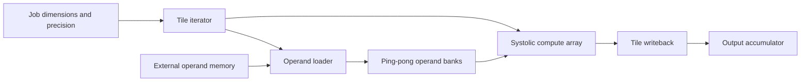

# TensorForge — Adaptive Mixed-Precision Systolic Array Accelerator

A parameterized SystemVerilog matrix accelerator with signed INT8 and packed INT4 arithmetic, autonomous operand staging, overlapped execution and a cocotb verification environment.

[](https://github.com/RianaMalhotra/Adaptive-Mixed-Precision-Systolic-Array-Accelerator/actions/workflows/rtl-ci.yml)
[](https://github.com/RianaMalhotra/Adaptive-Mixed-Precision-Systolic-Array-Accelerator/actions/workflows/synthesis.yml)

## Architecture



## Implemented capabilities

- Parameterized output-stationary systolic array: one signed INT8 MAC or two packed signed INT4 MACs per PE per enabled cycle.
- Variable reduction length, multi-tile matrix scheduling, boundary zero padding and accumulation across K blocks.
- Ping-pong operand banks and autonomous prefetch overlapping loading with compute.
- Fixed one-cycle SRAM loader and separate variable-latency ready/valid memory interface.
- Tile-level host register interface, completion interrupt and result-path fault diagnostics.
- Cocotb scoreboards, randomized stalls, boundary cases and memory transaction checks.
- Matched baseline/prefetch benchmark CSVs and FPGA compute-array synthesis sweep.

## Run locally

Linux or WSL, Python 3.11+, Verilator and GNU Make:

```bash
python -m pip install -r requirements.txt
make -C sim
make -C sim array
make -C sim prefetch
make -C sim handshake
make -C sim matrix_bench
make -C sim dfx
```

For FPGA synthesis install Yosys and nextpnr-ice40, then run:

```bash
python3 scripts/synth_array.py
```

## Performance and verification

| Study | Scope | Output |
|---|---|---|
| Matrix benchmark | Four shapes, both precisions, two architectures | Cycle counts, useful MACs/cycle, speedup |
| Fault campaign | 512 single-bit and 7,936 double-bit result-path injections | Detection CSV |
| FPGA sweep | 2×2, 4×4, 8×8 compute arrays | LUTs, registers, carry cells, routing status, Fmax when available |

These are implemented study configurations, not claims of passing results. Consult the latest workflow logs and artifacts for measured values. INT4 packs two independent signed nibble products per byte pair; comparisons between precision modes must account for different scalar MAC counts.

## Design documentation

- [Architecture and interface contracts](docs/architecture.md)
- [Double buffering](docs/double-buffering.md)
- [Pipelined operand loading](docs/pipelined-autoload-integration.md)
- [Matrix performance](docs/matrix-performance.md)
- [Tile performance](docs/performance.md)
- [DFX diagnostics](docs/dfx.md)

## Limitations

Behavioral operand/output memories are not physical SRAM macros. The handshake loader supports one outstanding request; the fixed-latency variant remains available for throughput comparisons. The register interface and fault monitor are tile-level, not integrated into every matrix top. Fault injection checks observable result corruption, not independent compute redundancy or manufacturing test coverage. FPGA synthesis targets the compute array only; no board bring-up, full-SoC timing or power measurement is claimed.

## Status

Implementation and test infrastructure are present. Final regression, benchmark and synthesis results must be checked before declaring the design validated.
